Papers: Glosten–Milgrom (1985) **[GM 1985]**, Glosten (1994) **[G 1994]** , Budish–Cramton–Shim (2015) **[BCS 2015]**, Hasbrouck (1991) **[H 1991]**. Kyle (1985) is background.

Understanding Order Book, theory and empirical study

## 1. Order book, spread and zero profit condition

### 1.1 Order book

The book is the list of standing orders to sell (asks) and to buy (bids), ranked by price.

- **Best bid** $b$: highest price a buyer (provider) is waiting to pay. **Best ask** $a$: lowest price a seller (provider) is waiting to accept.
- **Spread** $= a - b$. **Mid-price** $M = (a+b)/2$. **Half-spread** $= (a-b)/2$.
- A **limit order** names a price and waits; it may never trade. A **market order** trades immediately against the best prices, and a large one walks up the book level by level.

in **[GM 1985]**: a liquidity provider (the specialist) quotes a bid (buy) and an ask (sell). Customers arrive one at a time with market orders. A fraction $\alpha$ are **informed** (they know the value $V$); the rest are **noise** traders who buy or sell at random. The provider cannot tell who is who.

For the provider, his guess of the value $V$ is $M = E[V \mid \text{public info}]$. The provider only trades when someone chooses to trade with his quote, so he must price the quote conditioned on being traded with.

$$
\text{bid} = E[V \mid \text{public}, \text{someone sells}]<M<\text{ask} = E[V \mid \text{public}, \text{someone buys}].
$$

For the bid side, the provider is willing to buy at $b$, "Someone wants to sell" is bad news about $V$, so the provider must buy below $M$. For the ask side, the provider is willing to sell at $a$, "Someone wants to buy" is good news about $V$, so the provider must sell above $M$.

Condider a trade in which a taker buys at the ask (the provider sells) $A=\text{ask}$. Among buyers, let $\alpha$ be the share of informed trader among buyers, and let $I=E[V|\text{public}, \text{informed}]$ be what an informed buyer knows the share is worth. From a noise buyer the provider gains from the half spread $A - M$: the noise trader pays $A$ for something worth $M$ in expectation of public knowledge.

### 1.2 Zero profit condition

**[GM 1985]** assume that liquidity providers compete with each other and this competition drives expected profit to zero (**zero profit condition**) (**Bertrand Competition**: If one provider positive expected profits, other providers will quote a tighter spread and win the order flow, so his profit cannot persist.)

$$
(1-\alpha)\,(A - M) \;=\; \alpha\,(I - A)
\quad\Longleftrightarrow\quad
A = (1-\alpha)\,M + \alpha\, I .
$$

So the spread is what noise traders pay to cover the provider's losses to informed traders. More informed flow means a wider spread. Zero profit is an assumption, not a fact. It comes from competition among providers, and it removes one degree of freedom. In reality market makers earn money: markets are not perfectly competitive.

**[GM 1985]** prices one quote. **[G 1994]**  puts the same logic into a limit order book.

Many patient traders post limit orders; investors send market orders. A market order hits the book **level by level**. Each level is priced at the expected value *given that the order is big enough to reach it*, and big orders are more likely to be informed.
> Small trades pay a positive spread, large trades pay more per share. Limit orders profit on small trades and lose on large informed ones, about zero on average.

## 2. Stale quotes and sniping

Now suppose **nobody has private information**. The provider quotes around the value $M$: bid $= M - S/2$, ask $= M + S/2$. If the value jumps by $J$ and the provider has not yet updated, the ask is **stale**. It can be picked off only when $J > S/2$; the sniper's profit is $J - S/2$.

Value jumps $50 \to 53$, quotes are $49/51$ ($S=2$). There are $N = 4$ trading firms: 1 provider and 3 snipers. All see the news at the same time and the exchange processes messages one at a time in random order. (Here snipers use Immediate-Or-Cancel order i.e. **IOC order**)

| | Provider | Each sniper |
|---|---|---|
| Wins the race | $1/4$ (must beat all three) | $1/4$ each |
| If first | cancels safely | buys at 51 something worth 53: $+2$ |
| If not first | sold at 51 something worth 53: $-2$ | order cancelled: $0$ |
| Expected per jump | $-2 \times \tfrac34 = -1.5$ | $+2 \times \tfrac14 = +0.5$ |

The provider loses on average even though nobody knows more than anybody else. He earns it back from investors through a wider spread. 

In **[BCS 2015]**, free entry makes profit zero after speed costs(expected profits as a sniper minus the costs to speedup), and the cost is **borne**(paid) by investors(noise traders). An informed trader only trades if his edge beats the cost of crossing the spread. Buying at the ask costs $S/2$ above the mid, so an edge below $S/2$ gives negative expected profit and he does not trade.

| | Informed trader (GM, Kyle) | Latency sniper (BCS) |
|---|---|---|
| Knows | private information about fundamentals | the same public information as the provider |
| Edge | knowledge: sees the true value earlier | speed: acts before the provider can cancel |
| Risk | can simply be wrong on a given trade | almost none (IOC order is cancelled if he loses) |

## 3. Who gains, who loses

- **Noise traders** pay the spread to get their trade done right away rather than wait. This is a fee for speed, not a pure loss.
- **Provider** earns the spread from noise traders and pays informed traders **[GM 1985]** and snipers **[BCS 2015]**. Expected profit is about zero under competition (Bertrand Competition).
- **Informed traders / snipers** gain on average when their edge (information or speed) exceeds the half-spread.

For a market to exist some participants must be willing to lose on average. If everyone were rational and equally informed, nobody would trade (**Milgrom–Stokey no-trade theorem**).

## 4. Price discovery, Markout and Price Impact

### 4.1 Price Discovery

**Price discovery is how information enters the price.** **Markout** path is a consequence of the price discovery and is the way we mesure it.

| | Glosten–Milgrom | Budish et al. |
|---|:--|---|
| Information | held by informed traders, unknown to the provider | public: provider and takers see it at the same time |
| Enters the price through | informed **trades** and the provider's **Bayesian update** | the provider's **cancel**, slow and costly, so stale quotes get sniped |
| A trade tells us | something new | nothing new |

In **[GM 1985]** you (provider) do not know the information; someone (investor) trades and you update. In **[BCS 2015]** you know it already, but it still has to go through trades and cancels, and that is costly.

### 4.2 Markout

For **one trade** with direction $d$ ($+1$ if the taker buys, $-1$ if sells), price $p$, and mid $M_{t+\Delta}$ a time $\Delta$ later, we define the markout of the trader (taker) is:
$$
\text{markout}_{\text{taker}}(\Delta) = d\,\bigl(M_{t+\Delta} - p\bigr) = - \text{markout}_{\text{provider}}(\Delta) .
$$
Here $M_t=E[V|\mathcal{I}_{t}]$, $M_{t+\Delta}=E[V|\mathcal{I}_{t+\Delta}]$, since $\mathcal I_t \cup \{\text{trade}\} \subseteq \mathcal I_{t+\Delta}$(the information at time $t+\Delta$ contains the information at time $t$ and this trade), we have that:
$$
E[M_{t+\Delta}|\mathcal{I}_t, \text{trade}]=E[E[V|\mathcal{I}_{t+\Delta}]|\mathcal{I}_t, \text{trade}]=E[V|\mathcal{I}_t, \text{trade}]
$$
$E[V|\mathcal{I}_{t+\Delta}]$ is random from the view point of $\{\mathcal{I}_t,\text{trade}\}$, but $E[.|\mathcal{I}_t,\text{trade}]$ **averages over the information** that arrives between $t$ and $t+\Delta$ thus integrates out the new information. 

> The future mid $M_{t+\Delta}$ is an **unbiased but noisy** estimate of $E[V \mid \mathcal{I}_t, \text{trade}]$, and the trade price $p$ is known (the trade price). So **one markout of one trade** is one noisy observation of $E[V \mid\mathcal{I}_t, \text{trade}] - p$, and we need many observations (LLN) before the average converges.

| Object | What it is | Example ($M=50$, ask $=60$) |
|---|---|---|
| One trade | a single observation, very noisy | can be positive or negative |
| One trader, all trades | a wallet's average over its trades: that trader's edge | informed wallet $+40$, noise wallet $-10$ |
| All traders | all takers mixed together, $E[V \mid \text{all traders}]$ | $0.8(-10) + 0.2(+40) = 0$ |

Zero profit predicts that only the **last** one is zero. The middle one is what we look for in the data: wallets whose average markout is significantly different from zero.

### 4.3 Price Impact

We can decompose the markout into a part that is known at the time of the trade (the half-spread) and a part that is revealed afterwards (the price impact).
$$
\begin{aligned}
\underbrace{d(M_{t+\Delta} - p)}_{\text{taker markout}}
&= \underbrace{d(M_{t+\Delta} - M_t)}_{\text{price impact}}
- \underbrace{d(p - M_t)}_{\text{half-spread}}, \\[4pt]
\underbrace{d(p - M_t)}_{\text{half-spread}}
&= \underbrace{d(p - M_{t+\Delta})}_{\text{realized spread}}
+ \underbrace{d(M_{t+\Delta} - M_t)}_{\text{price impact}}.
\end{aligned}
$$

The price impact contains the information revealed by the trade, $E[V \mid \mathcal I_t, \text{trade}] - M_t$, plus noise from news arriving between $t$ and $t+\Delta$. The noise has mean zero given $\mathcal I_t$ and the trade, so the average price impact over many trades isolates the information content of the trade.
$$
M_{t+\Delta} - M_t
= \underbrace{\bigl(E[V \mid \mathcal I_t, \text{trade}] - M_t\bigr)}_{\text{The information of this trade}}
+ \underbrace{\bigl(M_{t+\Delta} - E[V \mid \mathcal I_t, \text{trade}]\bigr)}_{t\to t+\Delta \text{ new info}}.
$$

## 5. Price Discovery, Closer

### 5.1 Notations

In **[H 1991]** the notation differs from ours. We keep our notation and explain his here.

- **Quote.** The best bid $\cblue{b}=q^b$ and best ask $\cblue{a}=q^a$ of the whole market: posted by the providers (market-maker / specialist), faced by the takers (trader / trading public). We use the equivalent pair (mid, spread): $q^a = q + s/2$, $q^b = q - s/2$, $s = q^a - q^b$.
  - The mid tracks the value and carries the price impact; the spread is the provider's compensation (costs, adverse selection).
  - **$q_t$** is the mid set **after** trade $t$, so a trade meets $q_{t-1}$, which is our $\cblue{M_t}=\cred{q_{t-1}}$.
- **Clock time vs event time.** Our $\cblue{\Delta}$ is in seconds. **[H 1991]** counts events instead: $t$ goes up by one at every trade or quote change in the stock, by anyone, so $k$ steps ahead means $k$ **market events** later.
- **Efficient price.** $E[\cblue{V} \mid \Phi_t]=m_t$($m_t$ in **[H 1991]**), the expected value given public information right after trade $t$. It is not observed. **[H 1991]** first assumes the quotes are symmetric around it, so $q_t = m_t$ (his eq. (1)), which is our $\cblue{M_t = E[V \mid \mathcal I_t]}$; he later relaxes it.
- **Quote revision.** $r_t = q_t - q_{t-1}$, the change of the mid. Summing the increments gives the level difference, since the middle terms cancel: $\sum_{k=0}^{K} r_{t+k} = q_{t+K} - q_{t-1}$, our $\cblue{M_{t+\Delta} - M_t}$ with $\cblue{\Delta}$ counted in events.
- **Quote rule.** The 1989 data do not record who initiated a trade, so the sign is **inferred** from the prevailing quotes: above the mid is a buy, below is a sell, at the mid is unknown ($x_t = 0$). **Polymarket records the taker side directly**.
- **Innovation.** A time-series term, not "something new" in the everyday sense: the innovation of a variable is the part the past cannot predict, $y_t - E[y_t \mid \text{past}]$. It has mean zero and is uncorrelated with everything in the past. Example: if buys tend to follow buys and $E[x_t \mid \text{past}] = 0.6$, a buy ($x_t = +1$) has innovation $0.4$ and a sell has $-1.6$. **[H 1991]** has two:
  - $v_{2,t} = x_t - E[x_t \mid \Phi_{t-1}]$, the unexpected part of the trade, our $\cblue{d_t - E[d_t \mid \mathcal I_t]}$;
  - $\cred{v_{1,t}} = r_t - E[r_t \mid \Phi_{t-1}, x_t]$, what is left of the quote revision once the trade is known, read as public news, our $\cblue{R_{t+1} - E[R_{t+1} \mid \mathcal I_t, d_t]}$ (with $\cblue{R_{t+1} = M_{t+1} - M_t}$, defined in 5.2).
  - "The past" is the econometrician's data (past trades and quotes), which may be less than what traders know.

Within one event $t$, **[H 1991]** fixes the order below. It is a convention about the whole market, not about one trader or one provider. The quote is the best bid / ask of **all providers** and the news is seen by everyone. The trade $x_t$ cannot react to news of the same event; the new quote, and so $r_t$, reacts to both(public news and the trade $x_t$).

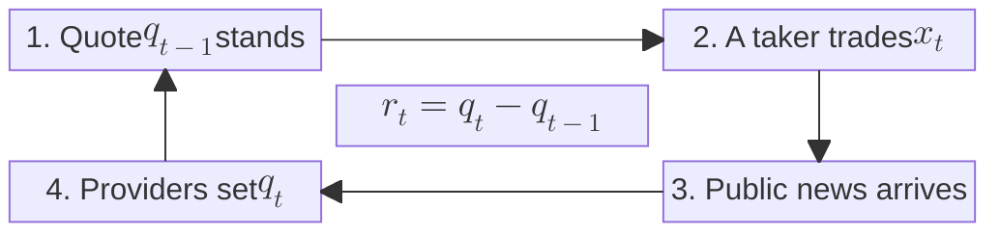

### 5.2 Equations

From here on $t$ counts events and $M_t$ is the mid just before event $t$. Define the change of the mid

$$
R_t = M_t - M_{t-1},
$$

so $R_{t+1} = M_{t+1} - M_t$ is the change across trade $t$, and $\sum_{k=1}^{\Delta} R_{t+k} = M_{t+\Delta} - M_t$ is our price impact.

**Equation (1): the mid is always the efficient price.**

$$
M_t = E[V \mid \mathcal I_t] \quad \text{for every } t. \tag{1}
$$

- This is what 4.2 assumed. With $\mathcal I_t \subseteq \mathcal I_{t+\Delta}$, the tower property gives $E[M_{t+\Delta} \mid \mathcal I_t] = E\bigl[E[V \mid \mathcal I_{t+\Delta}] \mid \mathcal I_t\bigr] = E[V \mid \mathcal I_t] = M_t$: the mid is a **martingale**, and its future changes cannot be predicted from $\mathcal I_t$.
- **[H 1991]** starts from (1) and later relaxes it to (3).

**Equation (2): a regression for the change of the mid.**

$$
R_{t+1} = \underbrace{a_1 R_t + a_2 R_{t-1} + \cdots}_{\text{past mid changes}}
+ \underbrace{b_0\, d_t}_{\text{this trade}}
+ \underbrace{b_1 d_{t-1} + b_2 d_{t-2} + \cdots}_{\text{past trades}}
+ \cred{v_{1,t}}. \tag{2}
$$

- **$d_t$: the observed trade.** $d_t \in \{+1, -1, 0\}$ is the direction of the taker trade at event $t$: $+1$ for a buy, $-1$ for a sell, $0$ if no trade happens (**[H 1991]**'s $x^0_t$). It is a number at every event. In (2) it enters as a number. In a conditional expectation, "given the trade" means given the value of $d_t$. The **information inside the trade** is the result of that conditioning, how far it moves the expectation of $V$:

  $$
  E[V \mid \mathcal I_t, \text{trade}] - E[V \mid \mathcal I_t]=E[V \mid \mathcal I_t, d_t] - E[V \mid \mathcal I_t].
  $$

  - Given $\mathcal I_t$, knowing $d_t$ is the same as knowing its innovation $d_t - E[d_t \mid \mathcal I_t]$, since the two differ by a known number. So only the innovation can carry information inside the trade; the predictable part (buys tend to follow buys) tells us nothing new.
  - So $b_0 d_t$ is the mid's reaction to the observed trade, not the trade's information content.
- $b_0$ is the immediate reaction of the mid to this trade; $b_1, b_2, \dots$ are delayed reactions to past trades (a slow quote); $a_1, a_2, \dots$ are momentum or reversal in the mid itself (overshoot, then come back if $a_1 < 0$).
- $\cred{v_{1,t}}$ is the part left unexplained, read as public news.
- **Why (2) conflicts with (1).** Under (1) the mid is a martingale, so it can only move on what $\mathcal I_t$ did not know. If any $a_i$ or $b_i$ ($i \ge 1$) is non-zero, past mid changes or past trades predict the next change, and (1) fails. In the data they are non-zero (**[H 1991]** Table II: $a_1 = -0.118$, $b_1 = 0.007$, both significant).

**Equation (3): the mid returns to the efficient price only in the long run.**

$$
\lim_{\Delta \to \infty} E[M_{t+\Delta} \mid \mathcal I_t] = E[V \mid \mathcal I_t]. \tag{3}
$$

- Write $M_t = E[V \mid \mathcal I_t] + u_t$, where $u_t$ is a temporary pricing error (slow quote, inventory, tick size). (1) says $u_t = 0$ always; (3) only says $E[u_{t+\Delta} \mid \mathcal I_t] \to 0$. (1) implies (3), not the other way, which is the sense in which (3) **relaxes** (1).
- Example: after a buy everyone knows $E[V]$ moved from 50 to 53, but the quote steps up one unit per event, $51, 52, 53$. At $M = 51$, $u = -2$: (1) fails, (3) holds.
- Consequence for 4.2: without (1), $E[M_{t+\Delta} \mid \mathcal I_t, \text{trade}] = E[V \mid \mathcal I_t, \text{trade}] + E[u_{t+\Delta} \mid \mathcal I_t, \text{trade}]$, and the last term vanishes only as $\Delta \to \infty$. A short-horizon markout still carries the temporary error, which is why **[H 1991]** measures the persistent impact.
- **Polymarket.** At settlement $M$ is replaced by $V$, so with the horizon running to settlement (3) holds exactly: $E[M_{\text{settle}} \mid \mathcal I_t] = E[V \mid \mathcal I_t]$. Before settlement (1) can fail, for example with a 1¢ tick or a stale book in the last seconds.

**Equation (4): a regression for the trade.**

$$
d_t = \underbrace{\phi_1 d_{t-1} + \phi_2 d_{t-2} + \cdots}_{\text{past trades}}
+ \underbrace{\psi_1 R_t + \psi_2 R_{t-1} + \cdots}_{\text{past mid changes}}
+ \cgreen{v_{2,t}}. \tag{4}
$$

- We write $\phi_i, \psi_i$ for **[H 1991]**'s $d_i, c_i$, which would clash with our $d_t$.
- **Buys tend to follow buys** means $\phi_i > 0$ (**[H 1991]** Table II: $\phi_1 = 0.167$, $\phi_2 = 0.120$, $\phi_3 = 0.078$). Trades also react to past mid changes: $\psi_1 = -3.647$, so after the mid rises a sell is more likely.
- Everything on the right except $\cgreen{v_{2,t}}$ is known at $\mathcal I_t$, so (4) splits the trade into an old and a new part:

  $$
  d_t = \underbrace{E[d_t \mid \mathcal I_t]}_{\text{predictable, old}} + \underbrace{\cgreen{v_{2,t}}}_{\text{innovation, new}} .
  $$

  Example: with only $\phi_1 = 0.167$ and a buy just before, $E[d_t \mid \mathcal I_t] = 0.167$. A buy then has innovation $0.833$, a sell $-1.167$, no trade $-0.167$.
- There is no $R_{t+1}$ on the right: the trade comes before the quote revision it causes, so it cannot react to it (see the timing above). In (2), by contrast, $R_{t+1}$ does depend on $d_t$.
- New is not the same as private. Noise traders also surprise the market, so only part of $\cgreen{v_{2,t}}$ is information: in the linear case the information inside the trade is $\lambda\,\cgreen{v_{2,t}}$, with $\lambda = 0$ if every taker is noise.

**Equation (5): the two innovations are pure surprises.**

$$
\begin{aligned}
&E[\cred{v_{1,t}}] = E[\cgreen{v_{2,t}}] = 0, \\
&E[\cred{v_{1,t}}\,\cred{v_{1,s}}] = E[\cgreen{v_{2,t}}\,\cgreen{v_{2,s}}] = E[\cred{v_{1,t}}\,\cgreen{v_{2,s}}] = 0 \quad (s \ne t).
\end{aligned} \tag{5}
$$

- They also satisfy $E[\cred{v_{1,t}}\,\cgreen{v_{2,t}}] = 0$ at the same $t$, because (2) already contains $d_t$: whatever in $R_{t+1}$ moves with the trade is in $b_0 d_t$, not in $\cred{v_{1,t}}$.
- So a shock to $\cgreen{v_{2,t}}$ can be studied on its own, holding all other shocks at zero. That is what (6) does.

**Equation (6): the information of a trade is the long-run change in the efficient price.**

Start from rest (all past $d$ and $R$ equal to zero), give one unit of trade innovation at $t$, $\cgreen{v_{2,t}} = 1$, set every other shock to zero, and run (2) and (4) forward:

$$
\begin{aligned}
d_t &= 1, \\
R_{t+1} &= b_0, \\
d_{t+1} &= \phi_1 d_t + \psi_1 R_{t+1}, \\
R_{t+2} &= a_1 R_{t+1} + b_0 d_{t+1} + b_1 d_t, \\
&\;\;\vdots
\end{aligned}
$$

These are the expected trades and mid changes that follow one surprise. Add up the mid changes:

$$
\alpha_\Delta = \sum_{k=1}^{\Delta} E\bigl[R_{t+k} \mid \cgreen{v_{2,t}} = 1\bigr] = E\bigl[M_{t+\Delta} - M_t \mid \cgreen{v_{2,t}} = 1\bigr]. \tag{6}
$$

- $\alpha_\Delta$ is the price impact of one unit of **surprise**, not of one raw trade. It includes the follow-on trades that (4) predicts and the slow adjustment of the mid in (2), all caused by this one surprise.
- By (3), as $\Delta \to \infty$ the temporary error $u$ dies out and $\alpha_\Delta$ converges to the change in the **efficient price**:

  $$
  \lim_{\Delta \to \infty} \alpha_\Delta = E[V \mid \mathcal I_t, \cgreen{v_{2,t}} = 1] - E[V \mid \mathcal I_t],
  $$

  the information inside one unit of trade innovation. This limit is **[H 1991]**'s measure of information.
- If (1) holds (no lags, $b_0 = \lambda$), $\alpha_\Delta = \lambda$ at every $\Delta$: the short and long horizons agree. When they disagree, the gap is the temporary part.
- For Ames Department Stores (**[H 1991]** Figure 1) a buy moves the mid by about \$0.014 at once and about \$0.028 after 20 events: the full impact is about twice the immediate one and arrives with a lag.

### 5.3 VAR

(2) and (4) together are a **vector autoregression** (VAR), a standard tool of time-series econometrics (Sims, 1980; see Hamilton, *Time Series Analysis*, ch. 10–11): several series modelled at once, each regressed on the past of all of them, and then simulated forward to see how a shock spreads (the *impulse response*). Macroeconomists use it to trace, say, a rate shock through output and inflation; **[H 1991]** uses it to trace a trade surprise through later trades and the mid. Two regressions, then one forward computation.

**What to regress.** Both equations, truncated at $K$ lags (**[H 1991]** uses $K = 5$), each by OLS on its own. Every regressor is observed data. Below, $a_i, b_i, \phi_i, \psi_i$ are the true coefficients and $\hat a_i, \hat b_i, \hat\phi_i, \hat\psi_i$ their OLS estimates (**[H 1991]**'s tables report the estimates without hats).

$$
R_{t+1} = \sum_{i=1}^{K} a_i\, R_{t+1-i} + \sum_{i=0}^{K} b_i\, d_{t-i} + \cred{v_{1,t}}, \tag{2'}
$$

$$
d_t = \sum_{i=1}^{K} \phi_i\, d_{t-i} + \sum_{i=1}^{K} \psi_i\, R_{t+1-i} + \cgreen{v_{2,t}}. \tag{4'}
$$

- (2') is (2) cut at $K$ lags: the mid change across trade $t$ on the last $K$ mid changes ($R_t, \dots, R_{t-K+1}$), this trade ($d_t$) and the last $K$ trades ($d_{t-1}, \dots, d_{t-K}$). It gives $\hat a_i, \hat b_i$.
- (4') is (4) cut at $K$ lags: the trade on the last $K$ trades and the last $K$ mid changes, with no $R_{t+1}$ on the right. It gives $\hat\phi_i, \hat\psi_i$, and its residual $\hat v_{2,t}$ estimates the trade innovation $\cgreen{v_{2,t}}$.

**Order of computation.**

1. Build $R_t$ and $d_t$ from the data, in event time.
2. Regress (2') to get $\hat a_i, \hat b_i$, and (4') to get $\hat\phi_i, \hat\psi_i$. The two regressions do not depend on each other.
3. Run (6): start from zero, set $d_t = 1$ (that is, $\cgreen{v_{2,t}} = 1$), keep every other shock at zero, and alternate between the two fitted equations, each step using the values already computed:

   $$
   d_t = 1
   \;\xrightarrow{(2')}\; R_{t+1}
   \;\xrightarrow{(4')}\; d_{t+1}
   \;\xrightarrow{(2')}\; R_{t+2}
   \;\xrightarrow{(4')}\; d_{t+2}
   \;\longrightarrow\; \cdots
   $$

   Written out, with every value before the shock set to zero ($d_s = 0$ for $s < t$, $R_s = 0$ for $s \le t$):

   $$
   \begin{aligned}
   R_{t+k+1} &= \sum_{i=1}^{K} \hat a_i\, R_{t+k+1-i} + \sum_{i=0}^{K} \hat b_i\, d_{t+k-i}, && k \ge 0, \\
   d_{t+k} &= \sum_{i=1}^{K} \hat\phi_i\, d_{t+k-i} + \sum_{i=1}^{K} \hat\psi_i\, R_{t+k+1-i}, && k \ge 1.
   \end{aligned}
   $$

   At each step $k$ compute $d_{t+k}$ first (it needs $R_{t+k}$), then $R_{t+k+1}$ (it needs $d_{t+k}$).

4. Add up the mid changes until the sum stops changing (**[H 1991]** stops at $\Delta = 20$):

   $$
   \hat\alpha_\Delta = \sum_{k=1}^{\Delta} R_{t+k}.
   $$

   Its limit as $\Delta \to \infty$ estimates the information of one unit of trade surprise. Since it is built from estimates, $\hat\alpha_\Delta$ is an estimate of $\alpha_\Delta$ in (6) and has sampling error; its standard error needs the delta method or a bootstrap.

### 5.4 Permanent and temporary price impact

With $M = E[V \mid \mathcal I] + u$ from (3), the impact of one unit of trade surprise splits into two parts:

$$
\alpha_\Delta
= \underbrace{\alpha_\infty}_{\text{permanent}}
+ \underbrace{\bigl(\alpha_\Delta - \alpha_\infty\bigr)}_{\text{temporary} \; = \; E[u_{t+\Delta} \mid \cgreen{v_{2,t}} = 1] \;\to\; 0}.
$$

- **Permanent**: the move in the efficient price, i.e. the information in the trade. It never reverses.
- **Temporary**: the pricing error $u$ (inventory, slow quotes, tick size, split orders). It dies out and can have either sign: overshoot in the toy model of §II ($2 \to 1$), undershoot for Ames Department Stores (\$0.014 → \$0.028). Almost every non-information effect is temporary, so $\Delta \to \infty$ removes them all.
- **Why it matters**: a short-horizon markout mixes the two parts, and only a long horizon splits the half-spread of 4.3 cleanly into realized spread and information. On Polymarket settlement gives the permanent part directly ($M = V$, $u = 0$).

### 5.5 When the reading fails

The VAR reads $\cred{v_{1,t}}$ as public news and $\cgreen{v_{2,t}}$ as private information plus noise. **[H 1991]** §III.B lists how this reading can fail. The estimates stay consistent; only the attribution goes wrong, and the paper offers no fix.

- **Quote setters know things too** (the specialist sees the book). Their information is not measured.
- **Public news leaks into $\cgreen{v_{2,t}}$** when the quote cannot follow it: price smoothing, stale reported quotes, stale limit orders that get picked off. The VAR then counts public news as trade information. Formally the reading needs $E[\cgreen{v_{2,t+k}} \mid \mathcal I^*_t] = 0$ for $k \ge 0$, where $\mathcal I^*_t$ is all public information, news included (his (14)).
- **Misspecification.** Another model gives other innovations, and another split.

**Polymarket.** Stale limit orders are the sniping of section 2: BTC moves on an outside exchange, the Up book lags, takers pick off the stale quotes before the close, and the VAR reports $\hat\alpha > 0$ although nobody has private information. A possible fix (ours, not in **[H 1991]**, in the spirit of Hasbrouck 1995): add the outside BTC price change as a regressor.

## 6. Example: taker markout in Polymarket BTC 5-minute markets (To Be Edit)

### 6.1 Setup

- **Data.** Pendulum mirror on Oak (`pmxt/v2`, order book and trades with millisecond timestamps), Polymarket data-api (wallets) and gamma (market info, resolution).
- **Sample.** 2026-08-06, 288 five-minute cycles. This is before the switch to 60-second TWAP settlement (2026-08-07), so every cycle settles on the Chainlink closing price.
- **Markout**, in cents per share, always for the **Up** token:
$$
\text{markout}_i(\Delta) = 100 \cdot d_i\,\bigl(M_{t_i+\Delta} - p_i\bigr).
$$
  - $d_i = +1$ for a **taker-long** trade (buy Up or sell Down), $d_i = -1$ for a **taker-short** trade (sell Up or buy Down). The price of a Down trade at $q$ is converted to $1-q$.
  - $M$ is the Up mid-price $(\text{best bid} + \text{best ask})/2$. At $\Delta = 0$ we use the book just before the trade (the trade timestamp minus 180 ms, because trade timestamps in pmxt are about 100–300 ms later than the book). Afterwards we use the last two-sided book at $t+\Delta$. Once the market has settled, $M$ is replaced by the final value $V \in \{0, 1\}$.
- **Averaging.** *Equal-weighted* (blue): every trade counts the same. *Volume-weighted* (orange): weights are shares. In the 288-cycle plots the shaded band (equal-weighted) and the thin orange lines (volume-weighted) are 95% **confidence intervals** clustered by cycle.
- **Sample filters and limits.** Gross of fees. Trades whose price falls on the wrong side of the reference quote (`wrong_side`, about 2.4%, mostly in the last seconds before the close) and trades with no mid-price are dropped. About 5% of trades are missing from pmxt because of WebSocket drops and are also dropped. Scripts: `scripts/btc5m/` in the research repo.

### 6.2 One cycle: `btc-updown-5m-1786057200`

2026-08-06 23:00–23:05 UTC, **Up won**. The book was very volatile in the last 10 seconds (Up dropped from about 0.95 to about 0.3) without flipping the outcome.

**One trade (Figure 1).** A taker bought 8 Up shares at 0.18, 102.5 s into the window, with a pre-trade mid of 0.175. The markout at $\Delta = 0$ is about $-0.5$¢ (half-spread). The dashed line marks the close of the window; after it the curve is flat at the realized payoff.

**The first 200 trades (Figure 2).** Gray lines are single trades and the blue line is their equal-weighted mean. The trades run from 298 s before the window opened to 122 s into it (negative time means before the open).

| *Figure 1. Markout of one taker-long trade.* | *Figure 2. First 200 taker-long trades, individual curves and their mean.* |
|:--:|:--:|
| 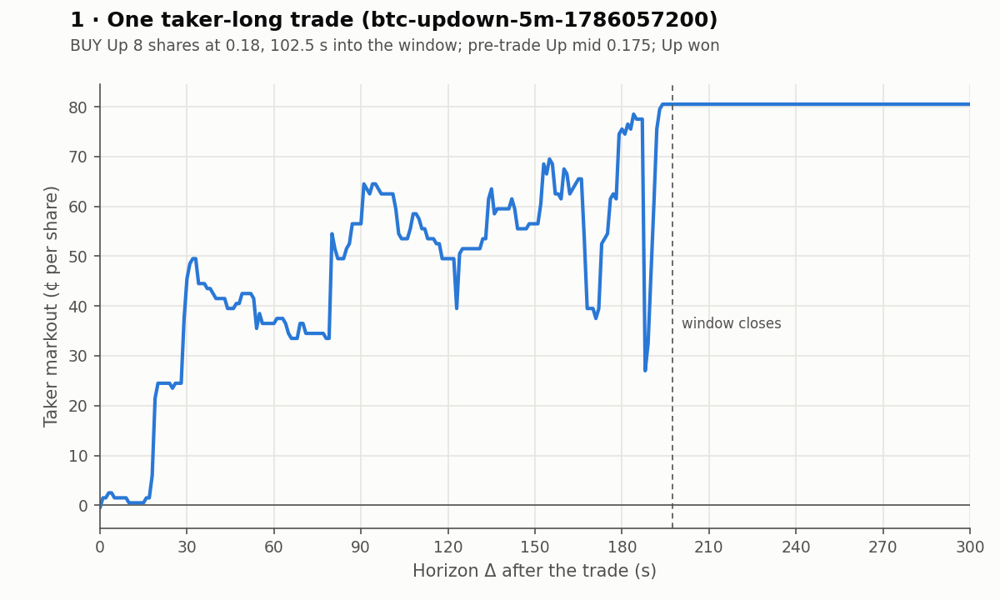 | 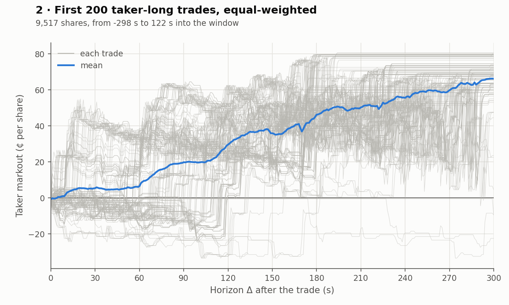 |

**All trades of the cycle**, long and short, equal-weighted and volume-weighted. Figures 3–6 share the same vertical scale.

| *Figure 3. All taker-long trades (853), equal-weighted.* | *Figure 4. All taker-long trades, volume-weighted.* |
|:--:|:--:|
| 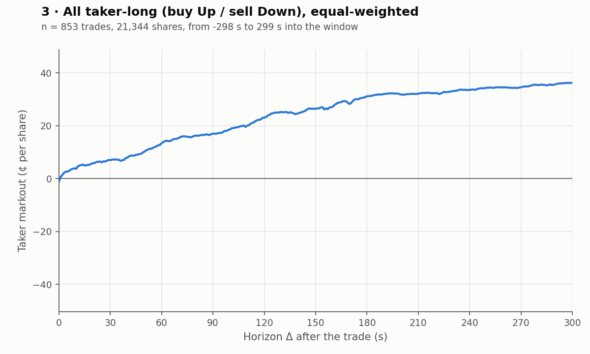 | 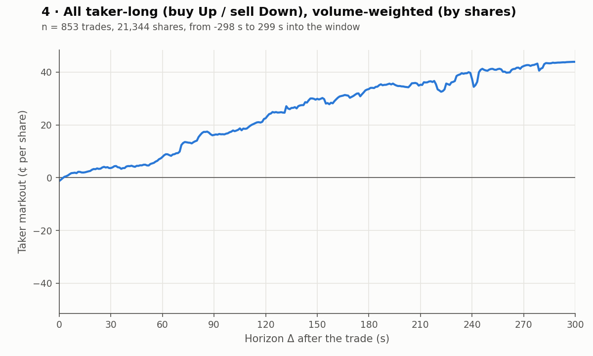 |

| *Figure 5. All taker-short trades (732), equal-weighted.* | *Figure 6. All taker-short trades, volume-weighted.* |
|:--:|:--:|
| 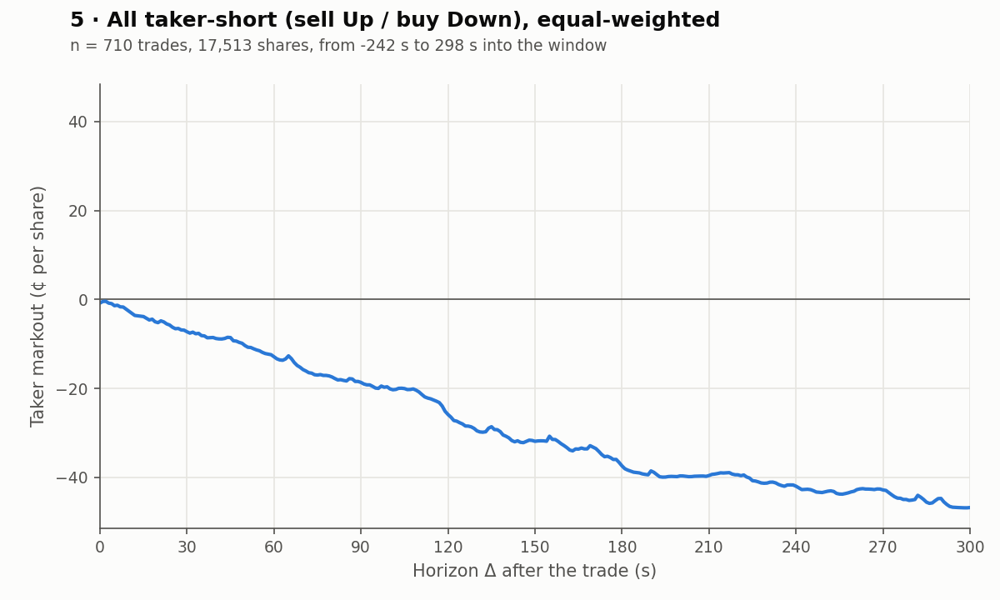 | 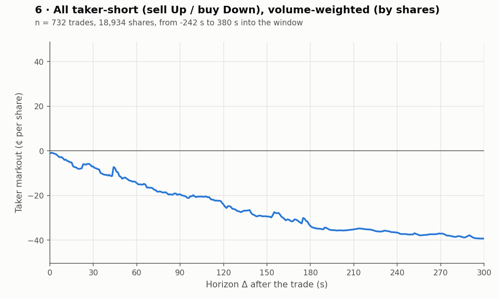 |

**What to take from it.** Up rose and won, so the long curves climb to about $+36$¢ (equal-weighted) or $+44$¢ (volume-weighted), and the short curves fall to about $-46$¢ or $-39$¢. These end values are mostly the realized payoff $100\,d\,(V - p)$ of this one cycle, not evidence that takers had information. Trades from the same cycle share one price path and one outcome, so they are not independent and no confidence band is drawn.

### 6.3 Several cycles pooled

Trades from all cycles are pooled and averaged together (cycles with more trades get more weight). We do not average cycle by cycle first.

#### 5 cycles (23:00–23:25 UTC, Up won 2 of 5)

With only five clusters we do not draw confidence intervals.

| *Figure 7. 5 cycles, all taker-long trades (2,722).* | *Figure 8. 5 cycles, all taker-short trades (3,216).* |
|:--:|:--:|
| 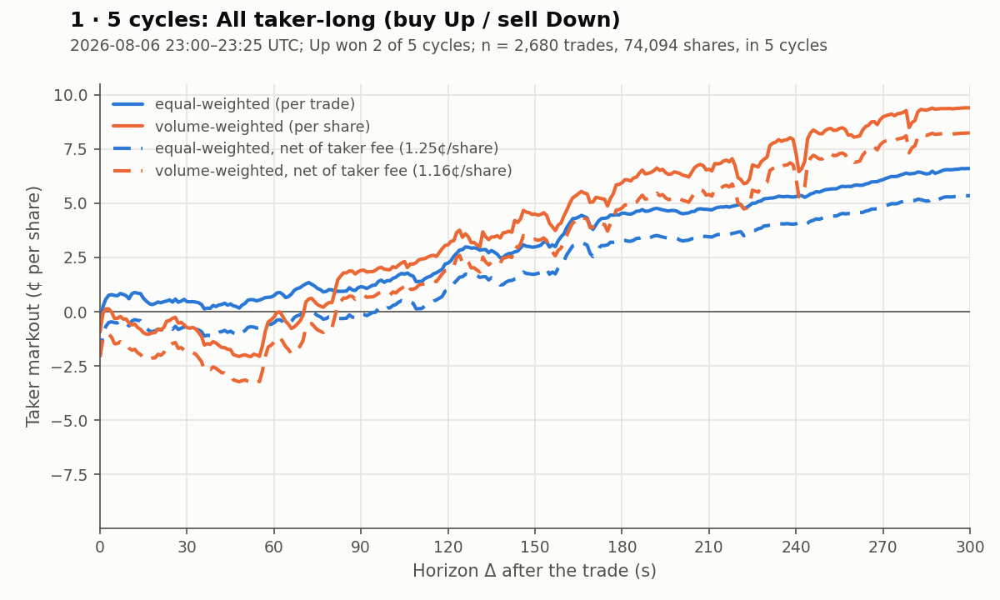 | 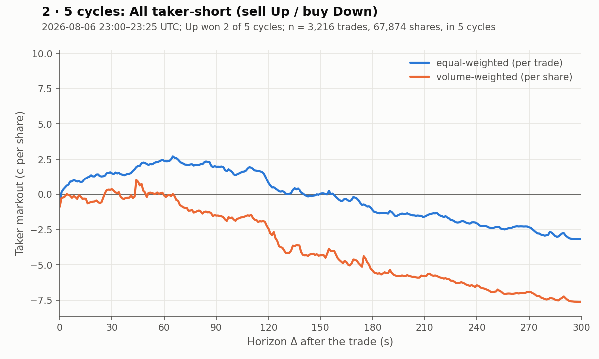 |

The equal-weighted and volume-weighted curves already disagree a lot (at $\Delta = 300$ s, long: about 6.5¢ vs 9.2¢; short: about $-3$¢ vs $-7.6$¢). With so few cycles, a handful of large trades decides the picture.

Wallet `0xe0229e10…` is the second-largest taker by volume in these 5 cycles, with balanced long and short trades. We follow it for all its taker trades (54), only its long trades (23), and only its short trades (31).

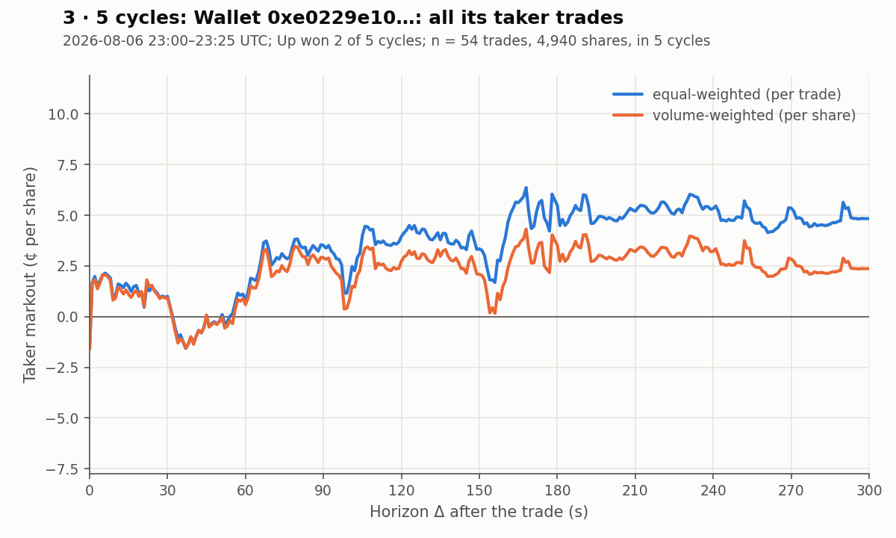

*Figure 9. Wallet `0xe0229e10…`, all its taker trades.*

| *Figure 10. Wallet `0xe0229e10…`, taker-long trades.* | *Figure 11. Wallet `0xe0229e10…`, taker-short trades.* |
|:--:|:--:|
| 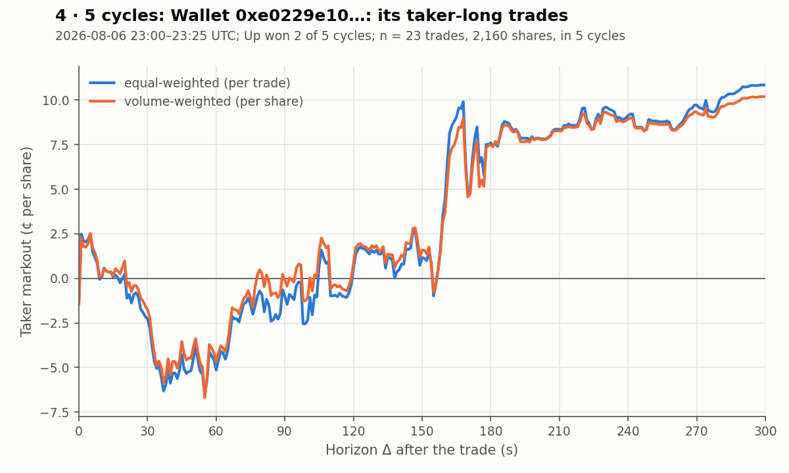 | 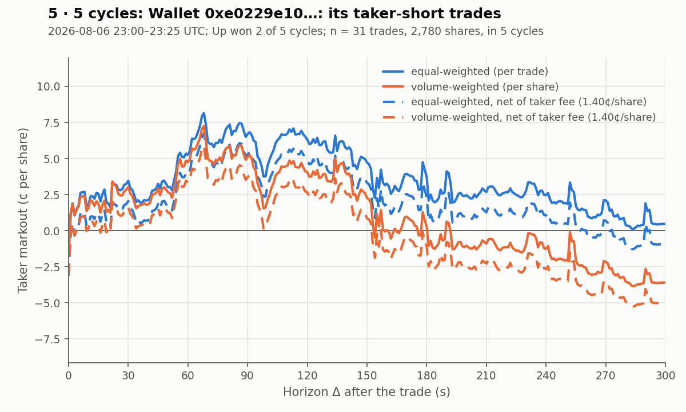 |

The numbers of trades are tiny, so these curves are mostly noise.

#### 288 cycles (2026-08-06, full day, Up won 133)

| *Figure 12. 288 cycles, all taker-long trades (242,937 trades, 7.39M shares).* | *Figure 13. 288 cycles, all taker-short trades (248,919 trades, 7.37M shares).* |
|:--:|:--:|
| 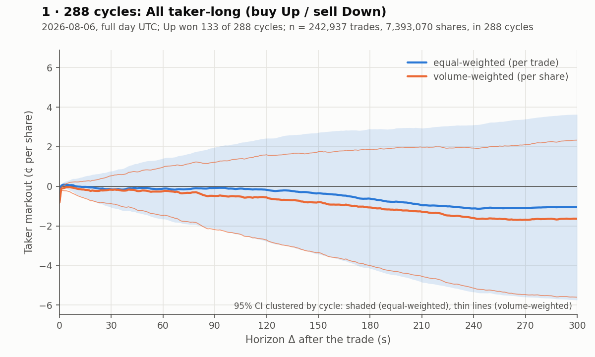 | 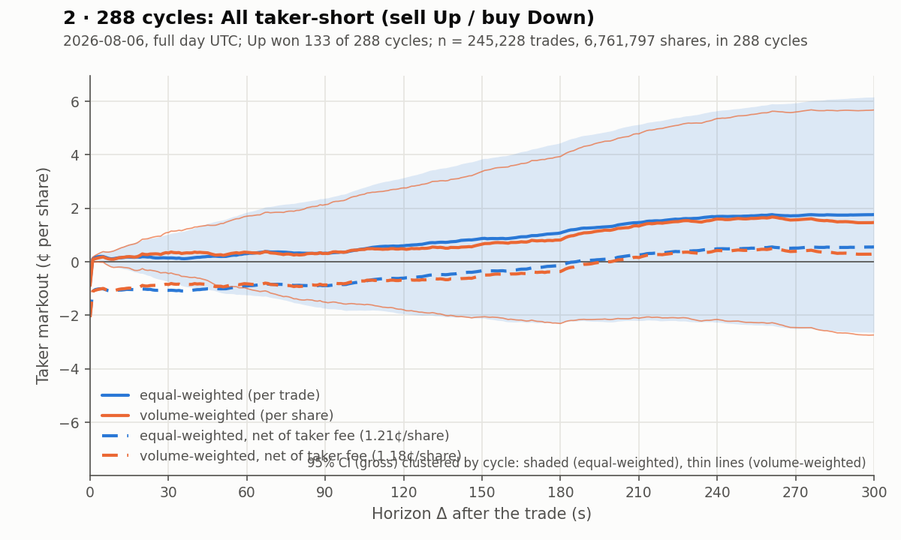 |

- At $\Delta = 0$ both curves start at about $-0.8$¢: the average half-spread paid by a taker.
- Within the first seconds the curves return to about $0$ (long about $0$, short about $+0.2$¢ at $\Delta = 10$ s): the price impact roughly offsets the half-spread. This is the qualitative shape the zero-profit model predicts for takers as a group.
- At $\Delta = 300$ s, long is about $-1$¢ (equal-weighted; $-1.7$¢ volume-weighted) and short about $+1.8$¢ ($+1.5$¢). The signs are what we would expect from Down winning more cycles that day (155 of 288), that is, from drift in the outcome, not from information.
- The 95% bands are several cents wide at long horizons (roughly $-5.5$ to $+3.5$¢ for long at $\Delta = 300$ s) and always contain $0$. We cannot reject zero, but with a band this wide, relative to a half-spread of about $0.8$¢, the test has little power.

Wallet `0x66b1c3fe…`: among wallets with at least 50 trades in each direction, the one with the largest taker volume (2,964 trades, 628,988 shares, active in 176 cycles).

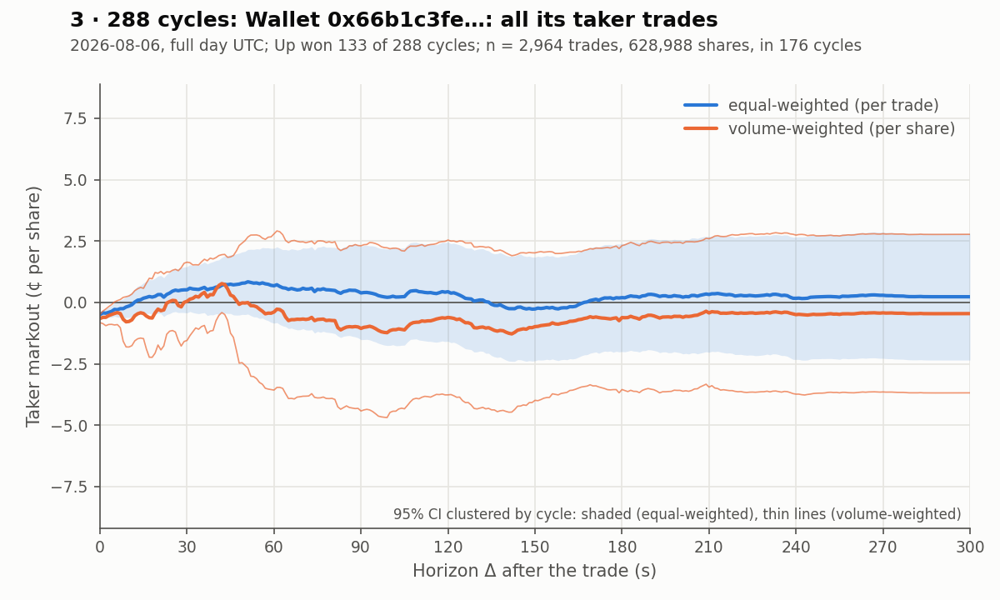

*Figure 14. Wallet `0x66b1c3fe…`, all its taker trades.*

| *Figure 15. Wallet `0x66b1c3fe…`, taker-long trades (1,370).* | *Figure 16. Wallet `0x66b1c3fe…`, taker-short trades (1,594).* |
|:--:|:--:|
| 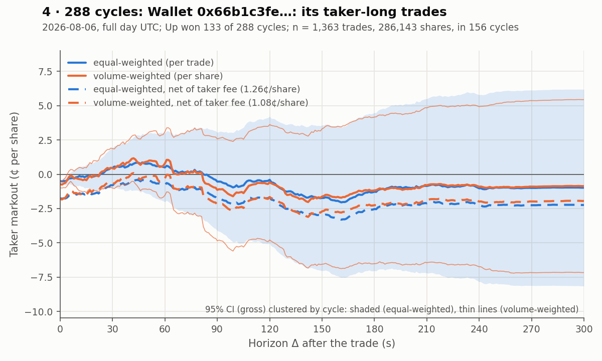 | 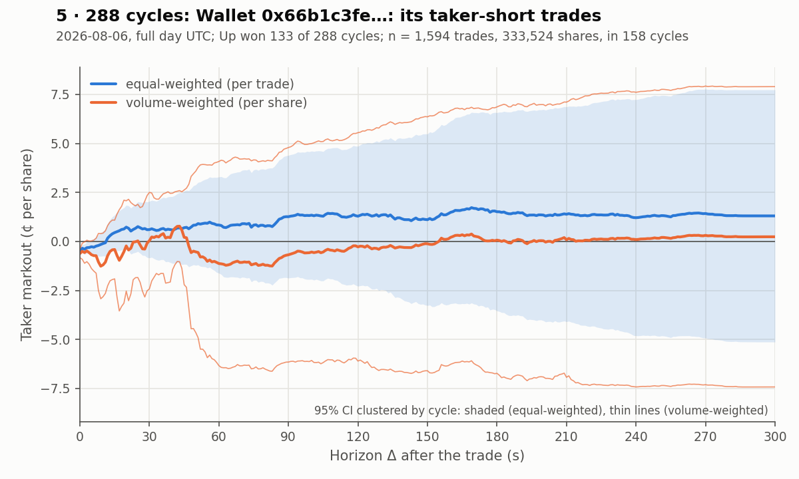 |

For all trades, the equal-weighted curve stays near $0$ (about $+0.2$¢ at $\Delta = 300$ s) and the volume-weighted curve near $-0.4$¢, with bands that contain $0$ throughout (the volume-weighted band is wider). The long and short curves separate somewhat but their bands are even wider. On this day there is no detectable edge for this wallet. It was chosen by volume, not by its markout, so there is no selection on the outcome.****

### 6.4 Caveats and next steps

- **Gross of fees.** The settlement-manipulation paper says the 5-minute contracts charged takers a fee from launch, peaking at even odds. I have not checked the fee on 2026-08-06, and it may be of the same order as the 0.8¢ half-spread.
- **One day.** Cycles on the same day share one market environment, so clustering by cycle may understate the uncertainty. More days are needed.
- **Long and short are plotted separately.** The zero-profit condition is about all takers together, so the next step is a single curve with long and short pooled, in which the drift of the day largely cancels.
- **Large $\Delta$ is not a pure mid-price markout.** For trades near the close, a large part of the horizon is after settlement, where $M$ is replaced by $V$. The curve then moves toward the unbiased payoff $d\,(V - p)$.
- **Fills vs orders.** It is not stated whether several fills of one taker order are merged into one trade. A marketable order that walks the book should be one observation.
- **Dropped trades.** `wrong_side` trades are concentrated in the most volatile seconds before the close, which are exactly where informed or sniping trades are most likely.

## References

- **[GM 1985]** Glosten, L. R. and Milgrom, P. R. (1985). Bid, ask and transaction prices in a specialist market with heterogeneously informed traders. *Journal of Financial Economics* 14(1), 71–100. [ScienceDirect](https://www.sciencedirect.com/science/article/pii/0304405X85900443)
- **[G 1994]** Glosten, L. R. (1994). Is the electronic open limit order book inevitable? *The Journal of Finance* 49(4), 1127–1161. [Wiley](https://onlinelibrary.wiley.com/doi/10.1111/j.1540-6261.1994.tb02450.x)
- **[BCS 2015]** Budish, E., Cramton, P. and Shim, J. (2015). The high-frequency trading arms race: Frequent batch auctions as a market design response. *The Quarterly Journal of Economics* 130(4), 1547–1621. [Oxford Academic](https://academic.oup.com/qje/article/130/4/1547/1916146)
- **[H 1991]** Hasbrouck, J. (1991). Measuring the information content of stock trades. *The Journal of Finance* 46(1), 179–207. [Wiley](https://onlinelibrary.wiley.com/doi/10.1111/j.1540-6261.1991.tb03749.x)
- Kyle, A. S. (1985). Continuous auctions and insider trading. *Econometrica* 53(6), 1315–1335. [JSTOR](https://www.jstor.org/stable/1913210)
