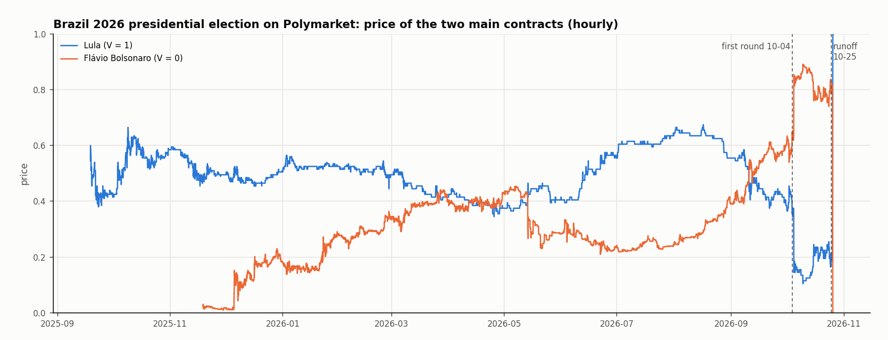
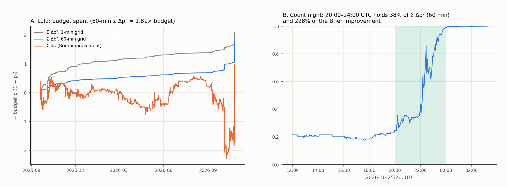
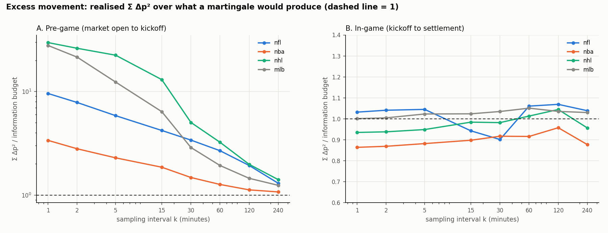
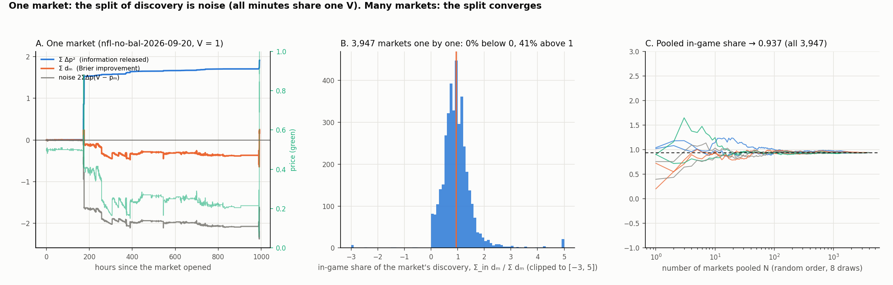

Data: Polymarket CLOB price history (about one point per minute) and every fill from the data-api, with the taker and maker wallet of each fill. A contract settles at $V \in \{0, 1\}$; the price $p_t$ is the market's probability that $V = 1$.

## 1. One market: the Brazil 2026 presidential election

Lula won ($V = 1$). His price opened at 0.5 in 2025-09, fell to 0.15 on the first-round count (2026-10-04, the wrong direction), stayed near 0.2 for three weeks, and went from 0.23 to 0.99 in the four hours of the runoff count (2026-10-25, 20:00–24:00 UTC).

## 2. Price discovery in one market

Price discovery is the price moving toward $V$. Measure the forecast error by the squared error $(V - p)^2$ (the Brier score). From the first price $p_0$ to the last $p_{\text{end}}$ the error falls by

$$
(V - p_0)^2 - (V - p_{\text{end}})^2 = p_0^2 - p_{\text{end}}^2 + 2V(p_{\text{end}} - p_0) = (p_{\text{end}} - p_0)(2V - p_{\text{end}} - p_0).
$$

Earlier minus later, so the number is positive when the error falls. The same identity holds minute by minute, and the sum telescopes:

$$
(V - p_0)^2 - (V - p_{\text{end}})^2 = \sum_{m=1}^{\text{end}} d_m, \qquad
d_m = (V - p_{m-1})^2 - (V - p_m)^2 = (p_m - p_{m-1})(2V - p_m - p_{m-1}).
$$

Each minute's $d_m$ can be assigned to a source (a phase, an event window, the wallets that traded that minute), and the parts add up to the total exactly. Write $\Delta p = p_m - p_{m-1}$; then

$$
d_m = \Delta p^2 + 2\,\Delta p\,(V - p_m).
$$

If $p$ is a martingale, $p_m = E[V \mid \text{information at } m]$, so the second term has mean zero and

$$
E[d_m] = \Delta p^2 = (p_m - p_{m-1})^2 .
$$

On average every price change is discovery, of size $\Delta p^2$. In one realisation a move can be informative and still point away from $V$ (a 20% event happens); then $d_m < 0$.

## 3. The information budget

Summing $E[d_m]$ and using $p_{\text{end}} = V$ and $V \sim \text{Bernoulli}(p_0)$:

$$
E\Big[\sum_m \Delta p^2\Big] = E\big[(V - p_0)^2\big] = p_0(1 - p_0).
$$

A martingale spends exactly the budget $p_0(1 - p_0)$ on average (Augenblick–Rabin 2021). The ratio

$$
\text{Ratio} = \frac{\sum \Delta p^2}{p_0(1 - p_0)}
$$

is 1 for a martingale. Above 1, part of the movement is noise that reverses (bid-ask bounce, quote flicker). For a segment, the budget is $p_a(1 - p_a) - p_b(1 - p_b)$, with $p_a, p_b$ the prices at the segment's start and end: pre-game $p_0(1 - p_0) - p_K(1 - p_K)$, in-game $p_K(1 - p_K)$, $p_K$ the price at kickoff.

**Brazil.** Over the whole life of the Lula contract, $\sum \Delta p^2$ is 2.09 times the budget on a 1-minute grid and 1.81 times on a 60-minute grid. The four hours of the runoff count hold 38% of $\sum \Delta p^2$ (60 min) and 228% of the Brier improvement: before the count the price had moved away from $V$ (the running $\sum d_m$ is negative), and the count night undid that and finished the job.

**Sports** (NFL, NBA, NHL, MLB; 3,947 game markets). Pre-game, the ratio is 3–30 on a 1-minute grid and falls to 1.1–1.4 at 4 hours: most pre-game movement at short horizons is bid-ask jumps that reverse. In-game, the ratio is 0.86–1.07 at every interval: in-game price changes are information.

### One market has only one $V$

In the noise term $2\,\Delta p\,(V - p_m)$, every minute and every trade of a market shares the same $V$. More trades within one market do not average it out: one market is one draw. The law of large numbers runs across markets, whose outcomes are independent.

Panel A follows one NFL market (Saints at Ravens, 2026-09-20; the Saints won, $V = 1$) whose price drifted down to about 0.2 for weeks before the game: in that market the in-game share of discovery is 246% and the pre-game share −146%. Panel B shows the in-game share market by market (41% of markets are above 1). Panel C pools $N$ markets in random order: the in-game share settles at 0.94 after a few hundred markets.

## 4. Quotes without trades

Taker and maker exist only for filled orders: each fill has one taker (the order that arrived and crossed the spread) and one maker (the resting order). Placing and cancelling quotes changes the best bid and ask, so the mid price moves and $\Delta p^2 > 0$, but there is no fill and the public order book carries no wallet. Minutes in which the price moves with no fill are therefore assigned to "quotes only", not to any wallet. A maker becomes visible only when a resting order is filled, and is then measured by settlement PnL.

## 5. Who has the edge, and is it speed?

The wallet that earned the most in a sample was partly lucky, so picking the top wallets and reporting their PnL is biased upward. Cross-fitting:

1. split the games into two halves (by event, since all fills of a game share one $V$);
2. on one half, pick the top 50 takers by settlement PnL, $\sum \text{direction} \times (V - \text{price}) \times \text{shares}$;
3. score them on the other half; swap the halves and pool.

If they are still good on the half they were not picked on, the group has a persistent edge. The figure comparing in-sample and out-of-sample PnL by league, and splitting the out-of-sample PnL by timing (pre-game, within 30 seconds after a score, other in-game), will be added here.
